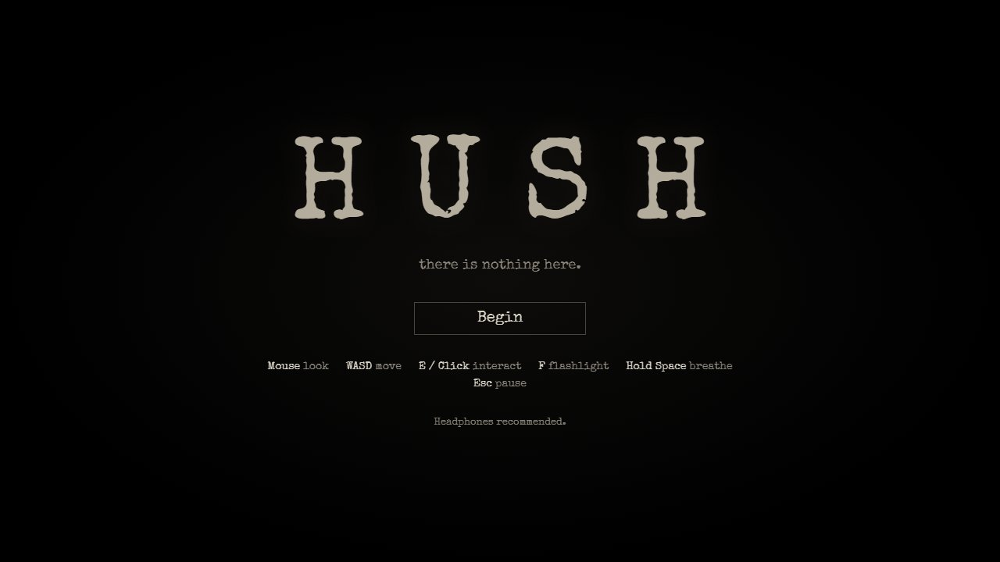
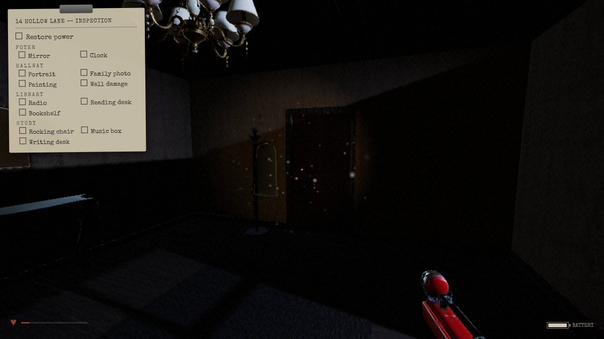
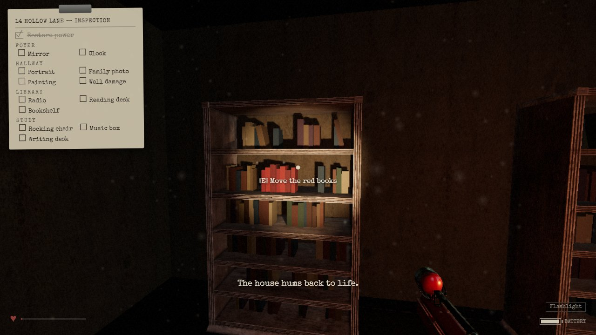
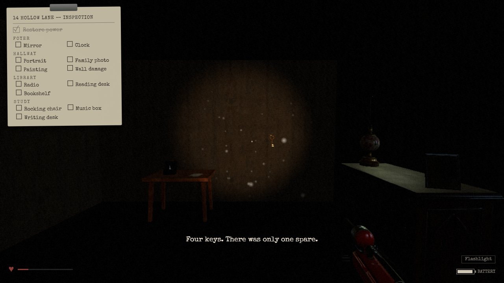
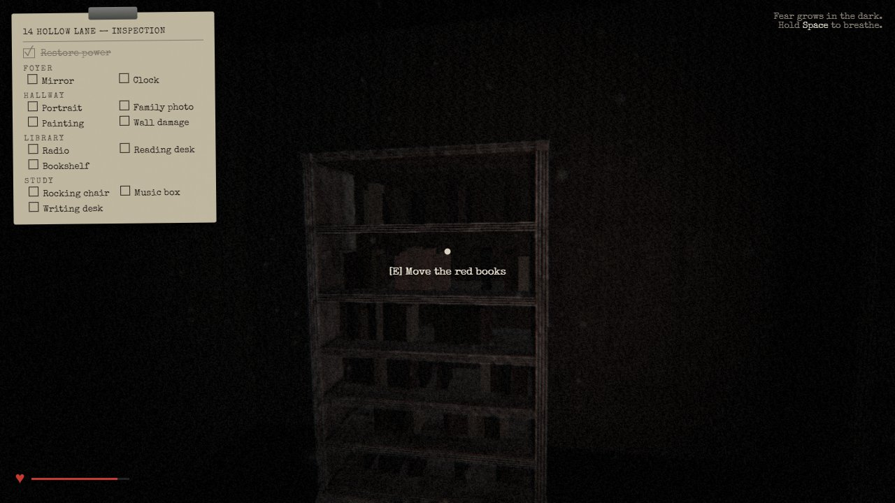
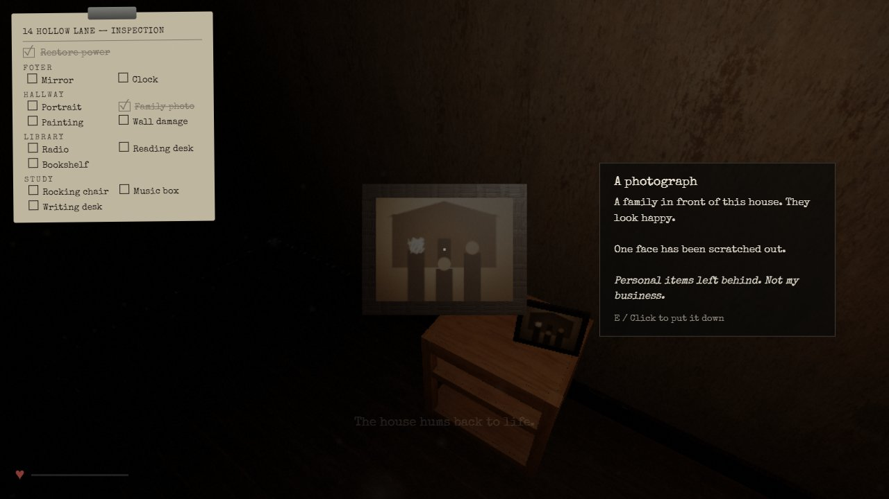

# HUSH

Mini game horor psikologis *first-person* berbasis **Three.js**.
UTS Grafika Komputer — *Three.js Interactive 3D Project* · Topik: **Interactive Haunted House** · Kategori: **Mini Game 3D**

> *14 Hollow Lane. Empty for years. Routine job: inspect it before Monday's sale.*



---

## Anggota Kelompok

| Nama | NRP |
|---|---|
| Randi Palguna Artayasa  | 5025231020 |
| Hikmia Sofia Nur Izzati | 5025231147 |

---

## Deskripsi

Pemain berperan sebagai **inspektur rumah** yang ditugaskan memeriksa sebuah rumah kosong sebelum dijual.
Tidak ada monster dan tidak ada *jumpscare*. Satu-satunya musuh adalah **Fear** (rasa takut) pemain sendiri:
semakin lama berada dalam gelap, rasa takut naik dan **cara dunia di-render ikut berubah**: lampu berkedip,
warna memudar, bayangan muncul di ujung penglihatan, dan benda-benda yang sebenarnya tidak ada.

Pemain datang untuk bekerja: menyalakan kembali listrik dan memeriksa setiap ruangan. Setelah semua selesai
dan pemain hendak pulang, barulah ia sadar pintu depan **terkunci dari luar**.

| | |
|---|---|
|  |  |
| Foyer: pintu depan, mantel, cahaya bulan | Perpustakaan setelah listrik menyala |
|  |  |
| Puzzle kunci: hanya satu yang asli | Ruangan yang sama saat Fear tinggi |

---

## Gameplay & Interaksi

**Tujuan:** clipboard di pojok kiri atas adalah **formulir inspeksi**. Pemain harus **menyalakan listrik**
dan **memeriksa setiap barang** yang tercantum di tiap ruangan (Foyer, Hallway, Library, Study), misalnya
*Mirror, Clock, Wall damage*. Formulir hanya menyebutkan **apa** yang harus diperiksa, tidak pernah **di mana**
letaknya atau **bagaimana** cara mencapainya. Setiap barang yang diperiksa memberi catatan singkat dari sudut
pandang inspektur.

**Alur permainan:**
1. Rumah gelap total. Pemain mencari sumber cahaya (senter ada di saku mantel dekat pintu).
2. Catatan di perpustakaan menunjuk ke rak buku; di balik **buku-buku merah** ada sekering.
3. Sekering dipasang di **kotak sekering** di ujung lorong: listrik menyala, pintu ruang kerja (*study*) terbuka sendiri.
4. Pemain memeriksa semua barang di formulir. Setelah lengkap, muncul baris **Leave**.
5. Saat hendak keluar, pintu depan ternyata **terkunci**. Tulisan tangan pemain sendiri muncul di formulir:
   *front door locked. from OUTSIDE?* dan *find a spare key*.
6. Di ruang kerja muncul **empat kunci**, tetapi hanya satu yang asli.
   *If it has no shadow, it isn't there*: kunci halusinasi **tidak memiliki bayangan**.
7. Kunci asli membuka pintu depan, dan pemain keluar.

**Fear (0–100):** naik di tempat gelap, saat menatap lukisan potret, saat kejadian aneh, dan saat menyentuh
halusinasi. Turun di ruangan terang, saat menahan napas (*breathing*), di dekat radio, dan saat melihat foto
keluarga. Semakin tinggi Fear, semakin banyak efek: lampu berkedip, kabut, vignette, warna pudar, *chromatic
aberration*, sosok bayangan, suara detak jantung, kamera bergoyang, dan benda yang berpindah saat tidak dilihat.

**Menang:** membuka pintu depan dengan kunci asli. **Kalah:** Fear mencapai 100 dan pemain pingsan.
Setelah keduanya pemain bisa bermain lagi; rumah "mengingat" berapa kali pemain sudah ke sana (tanda goresan
di dinding bertambah).

**Interaksi (E / klik kiri):** membuka pintu; memeriksa catatan, foto, potret, lukisan, cermin dan kursi goyang
(tampilan *inspect* 3D); mengambil senter, sekering, kunci, dan baterai; menyalakan saklar lampu, lampu minyak,
radio, kotak sekering, dan kotak musik.



---

## Kontrol

| Input | Aksi |
|---|---|
| Mouse | Melihat sekeliling |
| W A S D | Bergerak |
| E / Klik kiri | Interaksi (periksa, ambil, buka, nyalakan) |
| F | Menyalakan / mematikan senter |
| Tahan Space | Bernapas (menurunkan Fear, tetapi tidak bisa bergerak) |
| Esc | Pause |
| <kbd>`</kbd> | Menampilkan FPS dan resolusi render |

Disarankan memakai **headphone**: semua suara bersifat posisional (3D).

---

## Fitur Grafika

| Kebutuhan | Implementasi | File |
|---|---|---|
| Scene, camera, renderer | `WebGLRenderer` (ACES tone mapping, sRGB), `PerspectiveCamera`, render loop dengan `THREE.Timer` | `src/scene.js`, `src/main.js` |
| Environment | Rumah dibangun dari geometri, `FogExp2` (kepadatan mengikuti Fear), environment map HDRI (PMREM) untuk pantulan PBR, langit malam di luar jendela | `src/house.js`, `src/scene.js` |
| Geometry / material / mesh | Dinding dengan lubang pintu/jendela dari `BoxGeometry` dengan UV world-space; props prosedural (kunci, kotak musik, gantungan mantel, sekering, bohlam…); semua buku perpustakaan adalah satu `InstancedMesh` (1 draw call) | `src/house.js`, `src/props.js` |
| Scene graph (parent–child) | `head → camera → senter (SpotLight) + model tangan`; `doorPivot → pintu → gagang`; `musicBox → lidPivot → tutup`; `rockPivot → kursi` | `src/player.js`, `src/doors.js`, `src/props.js` |
| GLTF / GLB | 21 model furnitur/props dimuat dengan `GLTFLoader` sebagai file `.glb` (tekstur WebP, geometri terkompresi meshopt yang di-decode `MeshoptDecoder`) | `src/assets.js`, `scripts/optimize-assets.mjs` |
| Material PBR | `MeshStandardMaterial` dengan color/roughness/normal map; kunci dan gagang pintu dari kuningan memantulkan HDRI | `src/house.js`, `src/props.js` |
| Pencahayaan | Hemisphere (ambient), cahaya bulan `SpotLight` lewat jendela, senter `SpotLight`, lampu `PointLight` dengan bohlam emissive, lampu lorong yang berkedip | `src/scene.js`, `src/animation.js` |
| Bayangan | Senter dan cahaya bulan menghasilkan bayangan (pola silang jendela di lantai). **Bayangan adalah inti puzzle:** kunci halusinasi memakai `castShadow = false` | `src/player.js`, `src/game.js` |
| Animasi (6+) | Pintu berayun (tween), pintu kotak sekering (`AnimationMixer` + `AnimationClip` buatan sendiri), lampu berkedip (noise), tutup + penari kotak musik, kursi goyang, jarum jam, kamera sinematik di ending | `src/animation.js`, `src/game.js` |
| Raycasting | `THREE.Raycaster` dari tengah layar untuk hover/interaksi (dinding menghalangi); raycast ke bawah untuk menaruh barang di permukaan furnitur dan mencari tinggi rak buku | `src/interaction.js`, `src/props.js` |
| Interaksi (15+) | Lihat bagian *Gameplay & Interaksi* | `src/game.js` |
| Feedback visual | Highlight saat hover (emissive), prompt, pintu bergetar, percikan api, efek *dissolve*, lampu menyala, efek layar | `src/interaction.js`, `src/effects.js` |
| VFX | Shader post-processing Fear (vignette, desaturasi, chromatic aberration, grain, warp), partikel debu yang hanya terlihat di dalam kerucut senter (`ShaderMaterial` buatan sendiri), percikan sekering (`Points`), shader *dissolve* (`onBeforeCompile`), sosok bayangan di tepi pandangan, mata potret yang bercahaya | `src/effects.js`, `src/hallucinations.js` |
| Kamera & proyeksi | `PointerLockControls` first-person, head bob, goyangan dan distorsi FOV mengikuti Fear; `THREE.Frustum` menentukan kapan benda boleh berpindah tanpa terlihat; sosok bayangan muncul tepat di tepi FOV horizontal | `src/player.js`, `src/hallucinations.js` |
| UI / HUD | Clipboard formulir inspeksi (objektif), meter Fear, baterai, inventori, prompt, layar judul/intro/pause/akhir | `src/ui.js`, `src/style.css` |
| Menang / Kalah / Restart | Kabur → layar akhir; Fear 100 → pingsan → layar akhir; Play again / Title | `src/game.js` |
| Audio | Semua suara disintesis lewat kode (buffer Web Audio) dan diputar lewat `AudioListener` / `PositionalAudio` | `src/audio.js` |

---

## Cara Menjalankan

Kebutuhan: **Node.js 18+** dan browser modern (Chrome/Edge/Firefox) dengan akselerasi hardware aktif.

```bash
git clone https://github.com/miaikoo/hush.git
cd <nama-folder-repository>
npm install
npm run dev
```

Lalu buka **http://localhost:5173** di browser, klik **Begin**, dan klik layar untuk mengunci mouse.

Perintah lain:

```bash
npm run build     # build produksi ke folder dist/
npm run preview   # menjalankan hasil build produksi
npm run optimize  # membuat ulang public/ dari assets-src/ (hanya jika aset sumber diubah)
```

**Deploy:** `npm run build` menghasilkan situs statis di `dist/` yang bisa diunggah ke hosting statis apa pun
(GitHub Pages, Netlify, Vercel, itch.io). Path bersifat relatif (`base: './'`), jadi juga bisa dari subfolder.

**Mode debug:** `http://localhost:5173/?debug` langsung masuk ke permainan tanpa menu. Opsi tambahan:
`&cam=x,z,yawDeg[,pitchDeg]`, `&fear=60` (Fear tetap), `&power`, `&flash`, `&lamps`, `&keys`, `&real=0..3`.

---

## Pembagian Kontribusi

| Anggota | Kontribusi |
|---|---|
| _(isi nama)_ | _(isi kontribusi, misalnya: konsep & desain game, gameplay, level/props, UI, testing)_ |
| _(isi nama)_ | _(isi kontribusi)_ |

---

## Challenge

1. **Game "membeku" saat pertama kali melihat sebuah objek.** Shader dan tekstur baru di-compile/upload
   ke GPU saat objek pertama kali terlihat (sempat freeze 7 detik). Solusi: *warm-up pass* yang
   meng-upload semua tekstur dan me-render setiap ruangan dari beberapa arah sebelum game dimulai,
   ditambah `renderer.compileAsync`. Supaya tidak menambah waktu tunggu, proses ini berjalan di belakang
   layar judul.
2. **Perpustakaan terlalu berat.** Model buku yang diunduh ±44 ribu segitiga per buku, sehingga satu ruangan
   menjadi 1.090 draw call dan 1,9 juta segitiga per frame. Solusi: buku prosedural dalam satu `InstancedMesh`:
   61 draw call dan 139 ribu segitiga.
3. **Kamera melompat saat mouse digerakkan.** Pointer Lock di Windows kadang mengirim lonjakan gerakan mouse
   yang besar. Solusi: `requestPointerLock({ unadjustedMovement: true })` dan filter lonjakan.
4. **Sosok bayangan tidak pernah terlihat.** Awalnya muncul di sudut 55–80°, di luar FOV kamera. Solusi:
   menghitung FOV horizontal dari FOV vertikal dan *aspect ratio*, lalu memunculkan sosok tepat di tepinya.
5. **Ukuran aset terlalu besar untuk koneksi lambat.** Aset asli Poly Haven 42 MB dalam ±150 file.
   Solusi: skrip `npm run optimize` (satu `.glb` per model, tekstur WebP, geometri meshopt, HDR diperkecil):
   **8,3 MB dalam 46 request**. Di 4G lambat (1,6 Mbps) game siap dimainkan dalam ±47 detik.
6. **GPU bawaan laptop (integrated).** Solusi: resolusi render adaptif (mulai 75% di GPU integrated), satu
   pass post-processing dihapus (tone mapping digabung ke shader Fear), shadow map senter 512×512, dan hanya
   2 lampu yang menghasilkan bayangan.
7. **Petunjuk tanpa merusak suasana.** Playtester merasa progres "0/2" tidak intuitif. Solusi: formulir
   inspeksi yang menyebutkan nama barang per ruangan, tanpa pernah memberi tahu lokasi atau caranya.

---

## Struktur Project

```
src/
├── main.js           bootstrap, render loop, mode debug
├── config.js         ruangan, nilai tuning, tingkat Fear
├── scene.js          renderer, scene, fog, environment, lampu dasar
├── assets.js         loading GLTF / tekstur / HDR
├── house.js          dinding, lubang pintu/jendela, lantai, plafon, jendela
├── props.js          penempatan furnitur + props cerita prosedural
├── doors.js          pintu berengsel (scene graph + animasi)
├── player.js         kontrol first-person, collision, senter
├── interaction.js    interaksi raycaster + tampilan inspect
├── game.js           state machine, objektif, interaksi, ending
├── fear.js           meter Fear
├── hallucinations.js sosok bayangan, perubahan di luar pandangan, kejadian acak
├── animation.js      tween, kedip lampu, animation clip
├── effects.js        post-processing, debu, percikan, dissolve
├── audio.js          suara prosedural
├── textures.js       tekstur dari canvas (catatan, potret, foto…)
├── ui.js / style.css HUD dan layar
scripts/
└── optimize-assets.mjs  membuat public/ dari assets-src/ (npm run optimize)
assets-src/              file asli Poly Haven (tidak di-deploy)
public/                  aset siap web (hasil generate)
docs/screenshots/        screenshot untuk README
```

Dokumen desain lengkap (konsep dan keterkaitan dengan kebutuhan tugas) ada di [DESIGN.md](DESIGN.md).

### Optimasi Performa (ringkas)

- Unduhan **42 MB → 8,3 MB**, ±150 → 46 request (`scripts/optimize-assets.mjs`).
- Layar judul muncul segera setelah unduhan selesai; shader di-compile di belakangnya
  (tombol menampilkan *Preparing the house…* sampai siap).
- Tone mapping + konversi sRGB digabung ke shader Fear: satu full-screen pass lebih sedikit per frame.
- Shadow map senter 512×512; bayangan bulan statis (di-render sekali); hanya 2 lampu yang menghasilkan bayangan.
- Semua dinding digabung menjadi satu mesh; semua buku satu `InstancedMesh`.
- Resolusi render adaptif (turun saat FPS rendah, naik lagi saat ada ruang); GPU integrated mulai di 75%.

---

## Orisinalitas

Seluruh source code, komposisi scene, logika gameplay/interaksi/animasi, UI, shader, tekstur prosedural,
dan semua suara dibuat untuk project ini. Tidak ada template game atau project lain yang dijadikan dasar.
Konten eksternal hanya aset CC0 yang tercantum di bawah.

---

## Asset Credits

Semua model 3D, tekstur, dan HDRI berasal dari [Poly Haven](https://polyhaven.com) dengan lisensi
**CC0** (domain publik).

| Aset | Pembuat | Sumber | Lisensi |
|---|---|---|---|
| Arm Chair 01 | Kirill Sannikov | [polyhaven.com/a/ArmChair_01](https://polyhaven.com/a/ArmChair_01) | CC0 |
| Chandelier 01 | Kirill Sannikov | [polyhaven.com/a/Chandelier_01](https://polyhaven.com/a/Chandelier_01) | CC0 |
| Classic Console 01 | Kirill Sannikov | [polyhaven.com/a/ClassicConsole_01](https://polyhaven.com/a/ClassicConsole_01) | CC0 |
| Clipboard | ProgrammerOnCoffee | [polyhaven.com/a/clipboard](https://polyhaven.com/a/clipboard) | CC0 |
| Dark Paneled Wood | Dimitrios Savva | [polyhaven.com/a/dark_paneled_wood](https://polyhaven.com/a/dark_paneled_wood) | CC0 |
| Decrepit Wallpaper | Rob Tuytel | [polyhaven.com/a/decrepit_wallpaper](https://polyhaven.com/a/decrepit_wallpaper) | CC0 |
| Dining Chair 02 | James Ray Cock | [polyhaven.com/a/dining_chair_02](https://polyhaven.com/a/dining_chair_02) | CC0 |
| Dirty Carpet | Rohit Seervi | [polyhaven.com/a/dirty_carpet](https://polyhaven.com/a/dirty_carpet) | CC0 |
| Fancy Picture Frame 01 | Rob Tuytel, Rico Cilliers | [polyhaven.com/a/fancy_picture_frame_01](https://polyhaven.com/a/fancy_picture_frame_01) | CC0 |
| Gothic Commode 01 | Kirill Sannikov | [polyhaven.com/a/GothicCommode_01](https://polyhaven.com/a/GothicCommode_01) | CC0 |
| Hanging Picture Frame 01 | James Ray Cock | [polyhaven.com/a/hanging_picture_frame_01](https://polyhaven.com/a/hanging_picture_frame_01) | CC0 |
| Hanging Picture Frame 02 | James Ray Cock | [polyhaven.com/a/hanging_picture_frame_02](https://polyhaven.com/a/hanging_picture_frame_02) | CC0 |
| Old Room (HDRI) | Sergej Majboroda | [polyhaven.com/a/old_room](https://polyhaven.com/a/old_room) | CC0 |
| Old Wood Floor | Guillaume Monsergent | [polyhaven.com/a/old_wood_floor](https://polyhaven.com/a/old_wood_floor) | CC0 |
| Ornate Mirror 01 | James Ray Cock | [polyhaven.com/a/ornate_mirror_01](https://polyhaven.com/a/ornate_mirror_01) | CC0 |
| Power Box 01 | Rico Cilliers, Yann Kervran | [polyhaven.com/a/power_box_01](https://polyhaven.com/a/power_box_01) | CC0 |
| Rockingchair 01 | Jorge Camacho | [polyhaven.com/a/Rockingchair_01](https://polyhaven.com/a/Rockingchair_01) | CC0 |
| Rough Pine Door | Dimitrios Savva | [polyhaven.com/a/rough_pine_door](https://polyhaven.com/a/rough_pine_door) | CC0 |
| Side Table 01 | James Ray Cock | [polyhaven.com/a/side_table_01](https://polyhaven.com/a/side_table_01) | CC0 |
| Standing Picture Frame 01 | James Ray Cock | [polyhaven.com/a/standing_picture_frame_01](https://polyhaven.com/a/standing_picture_frame_01) | CC0 |
| Vintage Flashlight | Omar M. El-Safy | [polyhaven.com/a/vintage_flashlight](https://polyhaven.com/a/vintage_flashlight) | CC0 |
| Vintage Grandfather Clock 01 | Yann Kervran, James Ray Cock | [polyhaven.com/a/vintage_grandfather_clock_01](https://polyhaven.com/a/vintage_grandfather_clock_01) | CC0 |
| Vintage Oil Lamp | Monsta3D | [polyhaven.com/a/vintage_oil_lamp](https://polyhaven.com/a/vintage_oil_lamp) | CC0 |
| Vintage Radio Transceiver | Mateusz Sadek | [polyhaven.com/a/vintage_radio_transceiver](https://polyhaven.com/a/vintage_radio_transceiver) | CC0 |
| Vintage Wooden Drawer 01 | James Ray Cock | [polyhaven.com/a/vintage_wooden_drawer_01](https://polyhaven.com/a/vintage_wooden_drawer_01) | CC0 |
| Wooden Bookshelf Worn | Ulan Cabanilla | [polyhaven.com/a/wooden_bookshelf_worn](https://polyhaven.com/a/wooden_bookshelf_worn) | CC0 |
| Wooden Table 02 | Serhii Khromov | [polyhaven.com/a/wooden_table_02](https://polyhaven.com/a/wooden_table_02) | CC0 |
| Worn Plaster Wall | Dimitrios Savva | [polyhaven.com/a/worn_plaster_wall](https://polyhaven.com/a/worn_plaster_wall) | CC0 |

**Font:** [Special Elite](https://fonts.google.com/specimen/Special+Elite) (Astigmatic) dan
[Caveat](https://fonts.google.com/specimen/Caveat) (Impallari Type) lewat Google Fonts, lisensi SIL Open Font License.

**Audio:** tidak ada aset eksternal. Semua suara disintesis saat runtime di `src/audio.js`.

**Library:** [three.js](https://threejs.org) (lisensi MIT).

Daftar aset dalam format JSON ada di `assets-credits.json`.
